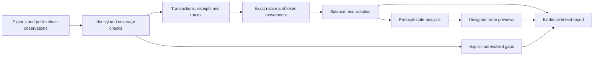

# Onchain Portfolio Reconstruction

Reconstruct supplied onchain movements, show which balances reconcile, and make unresolved evidence explicit.

This package extracts a small, runnable core from a **258-script, 17,599-line** research codebase spanning EVM and non-EVM systems. It documents the engineering surface through an [opaque scope manifest](docs/source-catalog.md), not a claim that every original script is portable or that every chain is covered by the CLI.

## Run it in two minutes

Requires Python **3.11 or newer**. The core and tests use only the standard library. Tested with Python 3.12. You do not need API keys, a wallet, financial exports, a model, Docker or dependencies for these examples.

From the directory containing this README:

```sh
python3 --version
python3 -m onchain_reconstruction.cli reconcile examples/ledger.json
python3 -m onchain_reconstruction.cli reconcile examples/ledger.json --format markdown
python3 -m onchain_reconstruction.cli decode-evm examples/evm-bundle.json
python3 -m onchain_reconstruction.cli import-csv examples/movements.csv
python3 -m onchain_reconstruction.cli build-dispatcher examples/preview-calls.json
python3 -m unittest discover -s tests -v
```

If `python3` is older, use your installed `python3.12` in those commands. No installation is required when running from this directory. An optional editable install, `python3 -m pip install -e .`, provides `onchain-reconstruct`; that build needs setuptools and may contact your package index. It is not part of the offline quickstart.

The ledger example uses **fictional movements**. It returns `complete: true`, `reconciled: true` and a zero raw-unit difference. A failed transfer contributes no principal movement; its gas is still charged. These results demonstrate supplied-input accounting, not exhaustive discovery of a real wallet.

For your own data, follow [input schemas and examples](docs/running.md). Exit status **0** means the requested command succeeded; reconciliation specifically requires complete supplied inputs and a zero difference. Exit status **2** means invalid/missing input, incomplete reconciliation, a discrepancy, or an RPC failure. Inspect the JSON and stderr rather than interpreting any error as a zero balance.

## Engineering scope

| Capability family | Engineering coverage | Portable package |
| --- | --- | --- |
| Input normalization | Structured movement imports, timestamps, exact raw units and source references | Normalized CSV import |
| Address and chain verification | Public-address validation, chain identity checks and bounded coverage rules | Explicit EVM address and chain-ID inputs; no seed handling or ownership inference |
| Transaction reconstruction | Receipt, trace, nonce and event processing across EVM and non-EVM adapter research | Bounded EVM sender-history search at fixed block boundaries |
| Exact accounting | Native/token movements, failed calls, gas and observed-balance comparisons | Offline receipt/trace decoder and exact-integer reconciliation |
| Protocol and asset adapters | Contract-state, bridge, migration, token and digital-asset investigation patterns | Scope documented; adapters remain research-specific |
| Read-only evidence collection | Request budgets, cache provenance, response integrity and failure classification | HTTPS RPC allowlist and local evidence cache |
| Unsigned route previews | Sequential-call layout and state-aware preview construction | Pure EVM preview-bytecode builder; no live simulation CLI or broadcast |
| Reporting and validation | Explicit unknowns, reconciliation output, validators and human-readable reports | JSON/Markdown output and tests |

See the [opaque 258-script scope manifest](docs/source-catalog.md), [capability coverage](docs/coverage.md), [architecture](docs/architecture.md), and [synthetic worked examples](docs/case-studies.md).

## How it works



The portable commands cover a subset of this investigation pipeline. The coverage table names the boundary for each stage.

## Optional live sender-history scan

This is the only CLI command that contacts a chain. It reads public data and writes a local cache. It sends **the address you supply** to your chosen provider. Use an HTTPS RPC with historical state and full block data, choose a small finalized block interval, and set an explicit request budget. Provider availability and archive access vary.

```sh
export CRYPTO_RPC_URL='https://YOUR-ARCHIVE-RPC'
python3 -m onchain_reconstruction.cli scan-nonces \
  --address YOUR_PUBLIC_EVM_ADDRESS \
  --chain-id YOUR_CHAIN_ID \
  --start FIRST_FINALIZED_BLOCK --end LAST_FINALIZED_BLOCK \
  --budget 200 --cache cache/rpc
```

Replace all placeholders. This example was **not** run against a live provider during packaging. It verifies chain ID, bounds the search, checks nonce coverage and refreshes boundary hashes before claiming success. It finds sender transactions only: incoming transfers, internal calls, token logs and account-abstraction user operations require additional sources. Non-transaction nonce changes or incomplete provider history cause a coverage failure rather than a false complete result.

## Scope and authority

- No wallet connection, private keys, seed phrases, signing, transaction broadcast or account login in the portable package.
- An observed balance is not proof of address control. A prior movement is not proof of a current balance. A successful preview is not execution or cash.
- The private source remains outside this release. This package excludes real addresses, exports, screenshots, credentials and response caches. Its sample addresses and transactions are synthetic.
- No license has been selected for redistribution yet. This local preparation does not publish the package or change ownership of third-party material.

## Standalone export

```sh
python3 tools/export.py --out /tmp/onchain-reconstruction
cd /tmp/onchain-reconstruction
python3 -m onchain_reconstruction.cli reconcile examples/ledger.json
python3 -m unittest discover -s tests -v
```

Choose a destination that does not exist. The allowlist copies only the portable code, synthetic examples, tests, docs and tooling; it never copies sibling investigation files, caches, a virtual environment or `.git`. A maintainer can put that exported directory into its own repository. [Development and history notes](docs/development.md) explain the local commits and source catalog.

