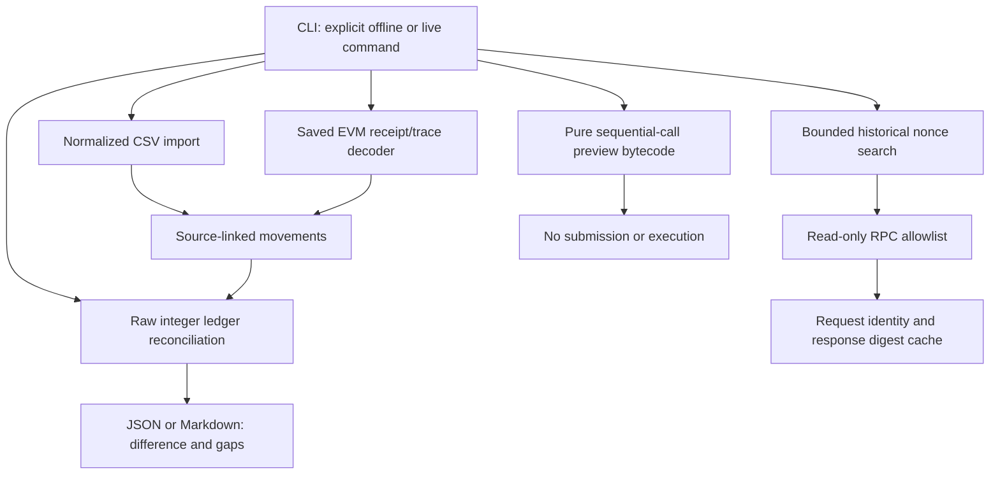

# Architecture and evidence boundaries

## Existing investigation versus extracted core

The original code is a research toolset, not a single application. Scripts read provider data and local exports, derive ledgers, test specific protocol routes and render a central report. Many have import-time work and fixed input paths. They must not be imported as a library merely to inspect them.

The portable extraction makes the shared accounting and discovery mechanisms explicit. No model is needed to perform the arithmetic. An agent can investigate a missing route or explain results, but unsupported prose must not fill a missing balance or turn a failed read into zero.

## Modules

| Module | Responsibility | Boundary |
| --- | --- | --- |
| `ledger.py` | Validate normalized movements, sum raw integers, retain unknowns and calculate differences | Complete means supplied inputs are complete, not all wallets/protocols discovered |
| `evm.py` | Decode native movements and ERC20 logs from supplied transaction/receipt/trace bundles | Caller establishes trace completeness, block identity and chain-specific fees |
| `rpc.py` | HTTPS reads, method allowlist, pacing, retry/budget, cached provenance and historical nonce search | Archive/full-block provider required; no signing methods |
| `dispatcher.py` | Construct a temporary code-only sequential-call preview program | Bytecode only; not an executed EVM test or deployable production wallet |
| `cli.py` | Explicit inputs and commands, JSON/Markdown output, nonzero failure status | Offline default; only `scan-nonces` performs network work |
| `tools/catalog_sources.py` | Parse every original Python file and record a privacy-safe scope manifest | Does not execute original modules or expose their names, hashes or literals |
| `tools/export.py` | Produce an independent allowlisted source directory | No original financial records, caches or repository history copied |

## Accounting invariants

`opening + settled inflows − settled outflows − actual gas = observed ending balance`

Use raw integers, not binary floating point. Gas from a failed transaction is still an expense. A reverted call subtree contributes no settled native transfer, even if the child trace itself has no error. ERC721 four-topic transfer logs are not ERC20 amounts. Self-transfers do not increase inventory. An ERC20 event is identified by chain, transaction and log index; duplicates are rejected.

The portable decoder requires an explicit `additional_fee_raw` for an outgoing transaction. Set zero only where the chain/receipt justifies it; L1-data fees and other chain-specific charges must not disappear because the EVM gas fields were present. The extraction does not compute rollup fee models.

```mermaid
stateDiagram-v2
    [*] --> Unobserved
    Unobserved --> Observed: valid source response
    Unobserved --> Unresolved: error, missing or unsupported field
    Observed --> Reconciled: complete supplied movements and zero difference
    Observed --> Discrepancy: nonzero difference
    Reconciled --> RouteInvestigated: protocol-specific evidence
    RouteInvestigated --> Previewed: unsigned simulation succeeds
    RouteInvestigated --> Blocked: unavailable state or route
    Previewed --> [*]: report only; execution outside this tool
```

## Cache behavior

Each successful RPC observation stores the exact JSON-RPC request, response, retrieval timestamp, opaque endpoint digest and SHA-256 response digest. The endpoint URL is not written because provider URLs can contain credentials. Cache keys include endpoint identity and request parameters. A changed endpoint does not reuse another provider's cache.

RPC errors, null results and HTTP failures are not cached as balances. HTTP 429 is retried at most twice after the initial request; every network attempt consumes the budget. A scan fails when evidence is unavailable. There is no broad fan-out or automatic paid-provider fallback.

Cached responses are for local replay and accidental-corruption detection, not cryptographic proof of provider honesty or an append-only audit log. A fresh refresh replaces the prior entry for the same request. The CLI bypasses cache for final boundary-hash checks. Choose finalized historical ranges: fresh endpoint checks do not prove every intermediate block belongs to a consistent canonical chain, and a dishonest provider remains outside the trust model.

## Simulation limitations

The original investigation used EVM code-only owner overrides for sequential unsigned `eth_call` previews, plus separate non-EVM simulation machinery. It did not fabricate protocol storage, allowances or balances to claim recoverability. The extracted builder preserves the layout fix separating large input calldata from previous-call output memory. Tests check encoding and the layout regression; no live provider or EVM interpreter was used in packaging, so runtime gas limits, opcode support, protocol behavior and final settlement remain unverified.

Other multi-chain adapters are catalogued rather than silently advertised as portable. No end-to-end tax computation, private chain balance reconstruction, universal discovery, investment recommendation or financial execution is implemented here.

