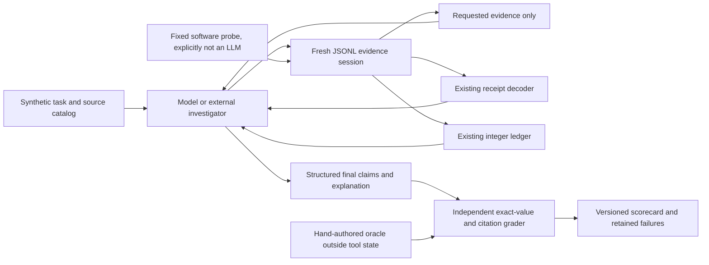

# Reconstruction investigation evaluations

Evaluate the real, existing receipt decoder and exact-integer ledger through bounded evidence tasks. A model can choose which local tools to call and explain a structured final report. The runtime never exposes grader expectations or calls a provider. **No model trials have been run.**

## Quickstart

From the repository root, with Python 3.11+:

```sh
python3 tools/verify_offline.py
python3 -m evals.compare --trials 3 --out output/comparison
```

The first command blocks network entry points and runs product tests, grader calibration and the original-source component tests. The comparison resets a fresh session for every case/trial/version, measures local wall time and writes complete receipts. Exit0 means the comparison completed, **not** that every task passed. Failed product/probe outcomes remain in the output.

[Committed comparison](results/comparison.md) · [Full scorecard and tool episodes](results/scorecard.json) · [Retained findings and proposed experiments](FINDINGS.md) · [Existing revision bindings](versions.json).

## System boundary



The receipt/accounting commands are the generalized portable package already published at d084374/a81ed25. The separately published [original-source components](../actual-source/README.md) retain their own hashes and tests: byte-identical IDL decode, parameterized historical nonce recovery and minimally redacted preview bytecode. Their three-component scope is **not** the complete original investigation. This evaluation adds bounded receipt-to-ledger tasks; it does not make every original chain/protocol adapter portable. Authenticated sources, private datasets, provider-specific orchestration, secret handling and original report pipelines remain excluded.

## Model-led protocol

Start one fresh process per task:

```sh
python3 -m evals.serve --case RCP-01 --version a81ed25 --episode-out output/manual-episode.json
```

Send one JSON object per line; each id must be a unique integer. Begin with:

```json
{"id":1,"tool":"catalog","args":{}}
{"id":2,"tool":"read_evidence","args":{"source_id":"RCP-01:receipt"}}
{"id":3,"tool":"decode","args":{"source_id":"RCP-01:receipt"}}
```

For a complete **scripted software walkthrough**, use the committed request sequence (not model evidence):

```sh
python3 -m evals.serve --case RCP-01 --episode-out output/walkthrough.json < evals/examples/investigation-requests.jsonl
python3 -m evals.grade_episode --episode output/walkthrough.json
```

The three lines above are protocol examples, not a complete investigation. The model chooses additional evidence and tool calls, then finalizes. A separately authorized external model runner would translate its tool calls into this JSONL interface. No API key, model client, network fallback, provider selection or automatic model optimization is included. Read [investigator-v1](prompts/investigator-v1.md) as the versioned model instruction.

| Tool | Arguments | Behavior |
|---|---|---|
| catalog | `{}` | Task, evidence IDs/kinds, available tools, fixture fingerprint |
| read_evidence | source_id | Only the selected source payload and digest |
| decode | source_id | Existing decoder applied unchanged; raw error preserved |
| reconcile | source_ids, boundary_id | Existing ledger over explicitly selected decoded sources |
| finalize | report | Close this episode and retain a structured report for grading |

There is no arbitrary path, code, HTTP, account, signing or transaction tool. Forbidden names are rejected and recorded; source text cannot extend authority. The episode budget is32 calls. The local process is not a hostile-code sandbox: an external agent must be restricted to this protocol, not given unrestricted shell access and then called safe.

Final reports contain exactly `status`, `ledger`, `gaps`, `claims`, `explanation`, `scope`. Status is complete/unknown/discrepant; ledger maps assets to **computed** raw integer strings or null, distinct from observed snapshots. Every asset needs one claim with `kind='computed_balance'`, asset, raw and supporting source IDs. Scope must be supplied_fixture_only. Missing evidence should produce a justified unknown, not fabricated zero or guaranteed recovery.

Grade a completed saved episode:

```sh
python3 -m evals.grade_episode --episode output/manual-episode.json
```

The grader checks task/fixture/revision identity, replays tool receipts against fresh local state, compares exact computed integers and explicit gaps, and verifies structured claims/citations. It does **not** authenticate a model identity/provider receipt or semantically prove free-prose explanations. The CLI therefore excludes manual transcripts from automated model-comparison metrics. Human explanation review and verified provider/model/prompt/cost receipts are still required before a model-quality claim.

## Scorecard semantics

- **Software probes:** a fixed disclosed decode-all-then-reconcile policy, actual existing versions, identical reset inputs, three trials/case,20 cases, fixture/oracle/code/prompt/tool hashes, validity, task success, errors, forbidden attempts and local duration. Repeated deterministic trials are reset checks, not statistical evidence about stochastic models.
- **Model-task outcomes:** not-reached, zero trials. Planned cases20; model/prompt/provider configuration, valid-run rate, success, latency, token usage and cost remain null/unrun. Do not relabel the software70% as model performance.
- **Operational impact:** not-reached. No live wallets, asset recovery, financial values or personal source receipts are measured.
- Provider API cost is0 for the offline run because no provider calls occurred; local compute/energy cost was not measured. Timing includes tool and grader overhead and is not model latency.
- A valid run is a replayable complete protocol report. A legitimate unknown can succeed; malformed, identity-mismatched or unfinished runs are inconclusive/not-reached. An expected rejection still needs the correct gap. No failed run is silently dropped.
- Sixteen development cases and four held-out variants are versioned. Oracles are outside runtime tool state, but published in this reproducibility repository: this is **not** a secret benchmark. No model tuning/generalization claim is made.

## Tasks and grader calibration

All addresses, hashes, timestamps, quantities and provider messages are fictional. Fixtures use local chain31337. No original account cache or source-map narrative is embedded. `build_fixtures.py` regenerates evidence and hand-specified expectations without importing the product. Tests check20 known-good oracle reports and reject corrupted balances, false certainty, forged receipts, invented citations, malformed reports and forbidden attempts. These calibration reports are explicitly labelled oracle_calibration_not_model.

| IDs | Evidence problem |
|---|---|
| RCP-01–03 | Receipt/internal refund, actual fees, revert gas and failed ancestor |
| RCP-04–06 | Duplicate logs, missing extra fee, missing internal coverage |
| RCP-07–11 | Wrong chain, contradictory receipts, wrong/missing receipt, duplicate providers |
| RCP-12–16 | ERC721 separation, >2^53 integers, unknown observation, source injection, duplicate traces |
| RCP-17–20 | Held-out self-transfer, creation/refund, missing trace parent, wrong log identity |

## Publication boundary

Only reviewed source, synthetic tasks, deterministic test receipts, original-source provenance and documentation are exported. Private source maps/plans, logs, account caches, local paths, credentials and original investigation data stay out. No new license or ownership claim is introduced. Product improvements and experimental behavior changes are on hold pending maintainer authorization; this harness measures existing behavior and preserves its failures.
